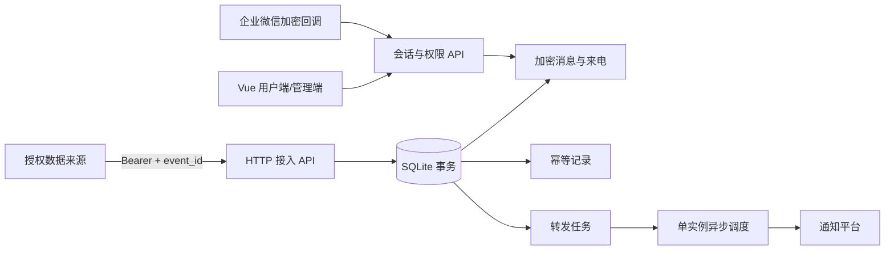

# 架构与开发



## 数据模型

| 表 | 用途 |
| --- | --- |
| users / sessions | PBKDF2 密码哈希、角色、停用标记；哈希会话与 CSRF、8小时到期 |
| managed_numbers / number_owners | 加密来源资料及 HMAC 索引、所有者、软删除 |
| ingress_tokens | 来源及所属用户、名称、密钥 SHA256、启用与使用时间 |
| ingress_receipts | token_id + event_id 唯一、输入摘要、生成记录 ID |
| messages | 加密记录、来源索引、接收/入库时间、已读与归档 |
| call_events | 加密事件、指纹、分组键和时间 |
| forward_channels / channel_owners | 加密凭据、规则、启用、起始水位及归属 |
| forward_jobs / forward_call_seen | 持久化重试队列、渠道+事件唯一约束、来电通知去重 |
| audit | 用户、动作、记录 ID 与时间，不记录正文或凭据 |
| site_settings / announcements / announcement_reads | 注册开关、公告和已读 |
| wecom_command_requests | 加密查询回复及请求去重、频率窗口 |

正文、发送方、来源资料和渠道凭据使用 Fernet 认证加密；时间、状态、关联关系和规则等元数据并非全部加密。密钥与数据库同卷，不能抵御宿主机管理员或主机失陷。全站来源标识唯一，可按自身场景使用命名空间，例如 `tenant-a:alerts`。

## 可靠性边界

接入的记录、去重回执及出站任务同事务提交。重启保留事件 ID 和队列；处于 sending 的任务改为 retry，标记结果未知。最多自动尝试8次，指数退避最高1小时；人工可重试最终失败任务。网络中断后的外部推送可能已经送达，因此不能承诺 exactly-once。自定义 Webhook 接收方应按任务 ID 去重。

HTTP来源的在线状态无法仅由接收服务推断；界面明确显示 HTTP 接入及最近提交时间，不显示虚构设备保活。来电展示依据上游事件，服务器不承担电话业务。

每次读取、写入、投递和企业微信查询都会核对相关归属。软删除和来源转移会撤销接入密钥；恢复后创建新密钥。转移历史数据是明确的管理员操作，旧所有者不再有历史访问权限。

## 本地开发

Python 3.12+、Node.js 22、pnpm 11.25.0。以下为 Linux/macOS shell 示例：

```sh
python3 -m venv .venv
. .venv/bin/activate
pip install -r backend/requirements.lock
cd frontend
pnpm install --frozen-lockfile
pnpm run build
cd ..
export SMS_DATA_DIR="$PWD/data"
export SMS_STATIC_DIR="$PWD/frontend/dist"
uvicorn app:app --app-dir backend --host 127.0.0.1 --port 8787 --workers 1 --no-proxy-headers --no-access-log
```

仓库不包含生产数据、凭据、原始抓包、APK/IPA 或协议 SDK。演示记录由登录用户主动创建并在 UI 标记；演示创建路径不调用转发入队函数。

待完善方向：用户可配置保留策略、队列监控、自动化回归覆盖、数据库迁移工具、PostgreSQL 与多实例任务认领。当前不把这些作为已完成功能宣传。
